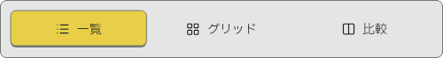
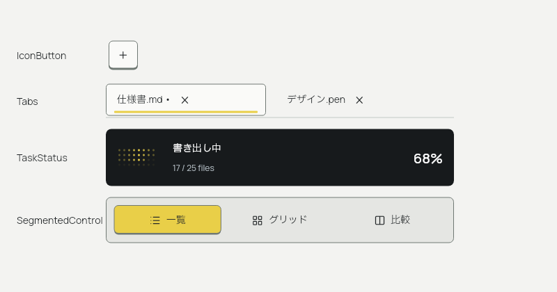

# Detent Design System

Flutter デスクトップ向けの UI パッケージ。`ui_design.pen` の48部品（C01–C48）を
`Nui` 接頭辞の Widget として実装しています。デザイン版は0.4、実装版は0.8.0です。操作アニメーションはFlutter、処理状態のアニメーションはRiveで実装しています。

## ギャラリー

白・グレー・黒の面に、黄色の選択表示と控えめな厚みを組み合わせた、道具らしいデスクトップUIです。
ボタンやノブは操作部として立体的に、一覧や文章は読みやすく平面的に表現します。
以下はデザイン画像ではなく、実装したFlutterギャラリーのスクリーンショットです（1440×1000px）。

### ライト：基本の操作部品

ボタン、キーキャップ、排他的な選択、チェックボックス、スイッチ、スライダー、ノブ、数値入力。
黄色は主要操作や選択に使い、細い輪郭と底面で操作面の構造を示します。


### ダーク：同じ部品を暗い作業環境へ

背景・操作面・文字の色を役割ごとに切り替え、黄色の選択表示を維持します。
ギャラリー上部からテーマ、高コントラスト、動きの抑制、表示密度を切り替えられます。


### 作業領域：情報を整理する部品

アプリのシェル、ヘッダー付きパネル、ツールバー、リサイズできる分割領域、ステータスバー、ツリー、データ表。
これらを組み合わせて、一覧と詳細を並べるデスクトップ画面を構成します。


### フィードバック：値と処理状態を伝える部品

ドット数字、メーター、進捗、通知、エラー、空状態、読み込み表示、タスク状態。
状態は色に加えて文字やアイコンでも伝えます。


ボタン・スイッチ・ノブ・選択面などの操作はFlutterで描画・アニメーションします。
ギャラリー上部の「Rive」は処理表示だけを切り替えます。操作部の動きは変わりません。

### Riveの動き

Progress・ライブMeter・処理中のTaskStatus・Skeletonを、実際の `.riv` から書き出したサンプルです。
メーターと進捗の値は固定し、処理中の光・ドット・掃引だけを動かしています。


選択面・輪郭・底面をまとめて動かす SegmentedControl。実際の Widget を撮影し、途中で方向を反転させています。





## 基本的な使い方

```dart
import 'package:flutter/widgets.dart';
import 'package:detent_ui/detent_ui.dart';

NuiApp(
  home: NuiAppShell(
    body: NuiPanel(
      header: const Text('プロジェクト'),
      child: NuiButton(
        label: '保存',
        variant: NuiButtonVariant.primary,
        onPressed: save,
      ),
    ),
  ),
)
```

全コンポーネントは `package:flutter/widgets.dart` の基礎 Widget で構成しています。
`NuiApp` も `WidgetsApp` を使用します。入力・メニュー・通知・ダイアログを含め、
MaterialApp、Scaffold、Material、Theme の祖先は必要ありません。
既存の `WidgetsApp` では、対象領域を `NuiTheme(data: data, child: ...)` で包んでください。
ポップアップやダイアログを使う場合は Navigator / Overlay が必要です（WidgetsApp の home / routes で用意されます）。

```dart
WidgetsApp(
  color: const Color(0xFFE9CF48),
  pageRouteBuilder: <T>(settings, builder) => PageRouteBuilder<T>(
    settings: settings,
    pageBuilder: (context, animation, secondaryAnimation) => builder(context),
  ),
  home: NuiTheme(
    data: const NuiThemeData(),
    child: NuiBox(body: YourScreen()),
  ),
)
```

テーマ切替は `NuiThemeMode`、範囲値は `NuiRangeValues` を使います。
0.6 以前の `materialTheme` は削除しました。`NuiToast.show` の戻り値は `NuiToastHandle` で、
`close()` で通知を閉じられます。値とイベントはアプリ側で管理します。

### Keycap の幅

```dart
Row(children: const [
  NuiKeycap(label: 'K'),                 // 1u（既定）
  SizedBox(width: 8),
  NuiKeycap(label: 'Shift', units: 1.5),
  SizedBox(width: 8),
  NuiKeycap(label: 'Enter', units: 2),
])
```

`units` はキー間隔を含めたピッチの倍率です。標準密度では 1u = 40px、1.5u = 64px、
2u = 88px、6.25u = 292px。幅は `(controlHeight + 8) * units - 8`、高さは `controlHeight + 2` です。
0.5u 以上の有限値を指定でき、押下状態や Rive の読み込みで配置寸法は変わりません。

### Select / ComboBox

入力枠・候補パネル・行・チェック表示・スクロールを共通実装にしています。
Select はホストが値を管理する選択専用、ComboBox は文字入力で候補を絞り込めます。
上下キー、Home / End、Enter、Escape、無効候補のスキップに対応します。
候補面は `.pen` に合わせて角丸6px、行高36px（拡大文字では伸長）、入力枠との間隔8pxです。


[ComboBoxの候補面](example/screenshots/combobox.png)・[Rive無効時の同寸描画](example/screenshots/static.png)も確認できます。

## 実装内容

- 全48 Widget: controls / inputs / navigation / layout / data / feedback。
- 正本JSONから生成した271トークン。4色テーマ、3密度、OSに追従するreduced motion。
- Manrope、IBM Plex Sans JP（400 / 500 / 600）をライセンスと共に同梱。
- Lucide 16px。`forui_lucide` はアイコン資産だけを供給し、ForuiのUI部品には依存しません。
- ボタンの配置領域は標準50px（操作面40＋底面2＋上下フォーカス余白8）。
- メニュー、検索、ショートカット記録、数値入力、ノブ、ツリー、リサイズ境界の操作。
- 表は固定ヘッダー＋遅延行構築。行の安定ID・選択・ソート通知をホストが管理。
- 通知のhover/focus中のタイマー停止、ダイアログの安全な初期フォーカスを指定するAPI。
- `example/lib/main.dart` に48部品、テーマ・密度・motion・Riveの切替、タスク状態の操作プレビュー。

## ギャラリーを実行

開発環境: Flutter 3.50.0-0.3.pre / Dart 3.14.0-294.0.dev。
この環境のSDKと既存のLucide資産に合わせ、Flutter >=3.47.0-0 / Dart >=3.13.0-0です。

```sh
cd example
flutter pub get
flutter run -d linux
```

Linux / macOS / Windows と Android / iOS の生成済みランナーを同梱しています。
対応方針はデスクトップ向けです。各OSでのビルド・実機動作とモバイル向けレイアウトは未検証です。
ATELIER-STUDIO側の既存UIの置き換えは行っていません。

## Rive

`assets/rive/detent.riv` はRive CLI 1.8.0で生成した、スクリプトなしのランタイムファイルです。
編集可能な制作ソースは `rive/detent/scene.rml`、プロパティとアニメーションの一覧は `assets/rive/manifest.json` にあります。
処理表示専用の7アートボード（Progress / CircularProgress / Spinner / Meter / TaskStatus / TaskGlyph / Skeleton）を収録しています。
操作部向けのアートボードは同梱せず、ファイルは25,491 bytesです（旧95,786 bytesから約73%削減）。

| 部品 | アニメーションの実装 |
|---|---|
| Button / IconButton / ToggleButton / Keycap | Flutter。押下60ms・復帰120ms、hover色の遷移 |
| Checkbox / RadioGroup / Switch | Flutter。選択120–160ms、スイッチのつまみ移動と途中反転 |
| SegmentedControl / Tabs | Flutter。選択面の220msスライド・途中反転、下線の遷移 |
| Slider / RangeSlider / RotaryKnob | Flutter。実値へ即時追従、操作中のつまみの反応 |
| TreeView / DotMatrix / InlineAlert / EmptyState | Flutter。展開矢印の回転、数字・状態の切り替え |
| Progress / Button loading | Rive。実進捗の光、不明時の流れる帯・回転弧。ボタンの操作面はFlutter |
| Meter | Rive。実値に同期する32本のバーに光の脈動。`active: false` で静止 |
| TaskStatus | Rive。処理中／キャンセル中のドット波、完了アイコン。完了後のループなし |
| Skeleton | Rive。読み込み中の掃引 |

`NuiApp` / `NuiThemeData` は `riveEnabled: true` が既定です。
`NuiApp(riveEnabled: false, home: ...)` で処理表示もFlutterの代替描画に切り替えます。
通常の操作部はこの設定によらずRiveの読み込み・コントローラー生成を行いません。

Flutterは値・イベント・編集・Focus・Semanticsを管理します。操作の結果はアニメーションの終了を待たず通知されます。
通常ボタンはSpace / Enterを離した時点で確定し、Escapeで中止できます。

高コントラスト、reduced motion、Rive無効化、読み込み失敗では処理表示をFlutter描画へ切り替えます。
Riveファイルは使用中共有し、controller / view model / bindingは各表示で分離・破棄します。
画面外・TickerMode無効・バックグラウンドでは停止し、復帰時に現在の値を反映します。
進捗率とメーターは実データを保ち、演出で架空の値を生成しません。
進捗未取得のTaskStatusは率を表示せずドットの波で活動を伝え、待機・完了後は静止します。

独自の処理表示にも `NuiRiveArtwork` を利用できます。描画はIgnorePointer / ExcludeSemantics付きで、
ラベルはホスト側に用意してください。

```dart
SizedBox(
  width: 32, height: 32,
  child: NuiRiveArtwork(
    artboard: 'Spinner',
    state: NuiSkinState(progress: .25, indeterminate: true),
    fallback: SizedBox.shrink(),
  ),
)
```

`progress` は0…1、`indeterminate` は処理中のループ、Progressの `taskState: 1` は実進捗の光です。
`TaskGlyph` の `taskState` はidle=0 / running=1 / success=2 / error=3 / canceled=4 / canceling=5。
メーターのバー本数を標準32以外に指定した場合は、指定本数のFlutter描画を保持します。
0.7からの移行では、独自の `NuiRiveArtwork` に操作部のアートボード名を指定していた箇所を通常のWidgetへ変更してください。

`rive` runtimeは0.14.11に固定。Linuxの初回テスト前は `dart run rive_native:setup --platform linux` を実行します。

```sh
python3 tool/generate_tokens.py
python3 tool/generate_rive.py
rive rive/detent --verify
rive inspect rive/detent --json
rive rive/detent --once
python3 tool/render_motion_preview.py  # Rive CLI + ffmpegでGIF再生成
```

Riveアカウントへのpush・publishは行いません。ローカルの未署名・スクリプトなしファイルです。

## 検証

パッケージルートから実行します（RiveのLinuxテストライブラリ探索の基準位置です）。

```sh
flutter analyze
flutter test
flutter test example/test/gallery_test.dart
```

テスト範囲: 押下cancel・二重発火抑制・外部値更新・キーボード・数値制約・通知タイマー・
表の遅延構築・メニュー終了・Rive障害時代替・7アートボードの実runtime読込とdata binding、Flutter操作部の移動・途中反転・画面外／背景停止・フォーカス維持。
ギャラリーは4テーマと文字200%、幅1024 / 1440 / 1920を確認します。
OS実機のIME・スクリーンリーダー・DPI・性能測定は別途必要で、Verified認定ではありません。

設計の根拠: `DESIGN_SYSTEM.md`、`SPECIFICATION.md`、`ui_design.pen`、`component_registry.json`。

### 動きの負荷を確認する

ギャラリーのデバッグ実行には開発用の負荷が含まれます。性能の確認は profile ビルドで行います。

```sh
cd example
flutter run --profile -d web-server --web-port 48732 --dart-define=DETENT_PERF=true
```

`DETENT_FRAME` に5秒区間のフレーム数、Flutter build / raster の中央値と95パーセンタイルを出力します。
同じ表示位置で Rive を切り替えて比較してください。通常の起動では計測しません。
Rive の描画を再描画境界で分離し、画面外の代替進捗アニメーションも TickerMode で停止します。
