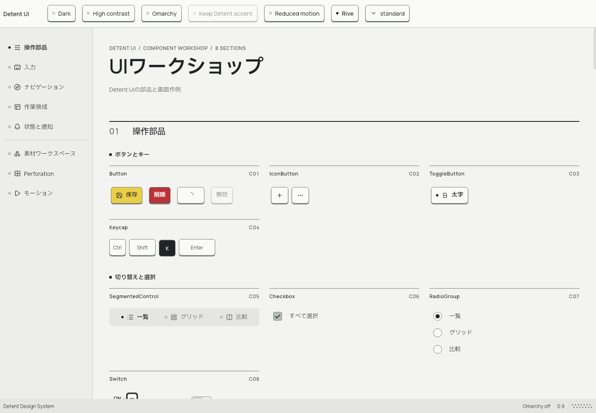
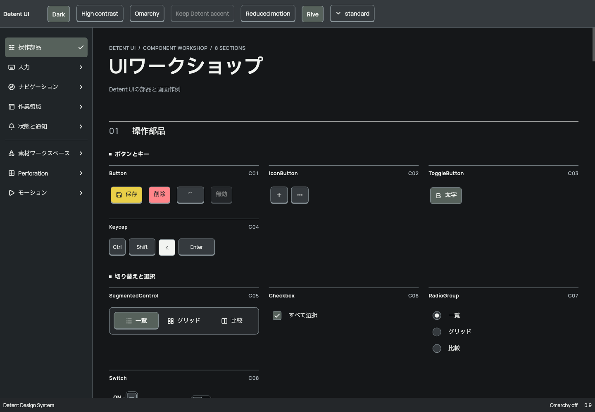
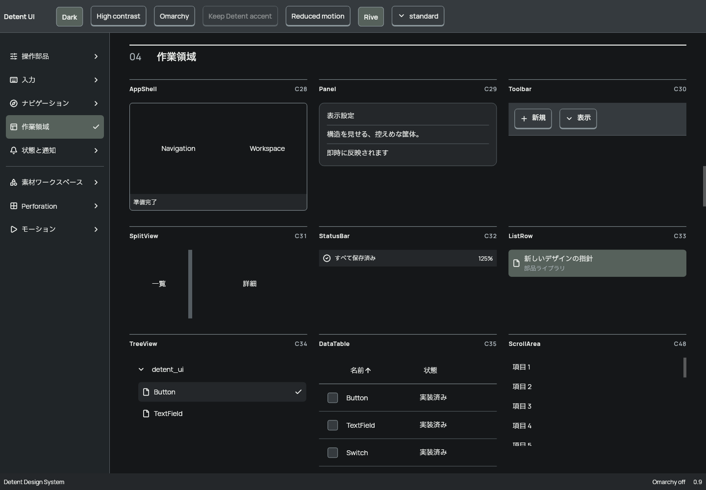
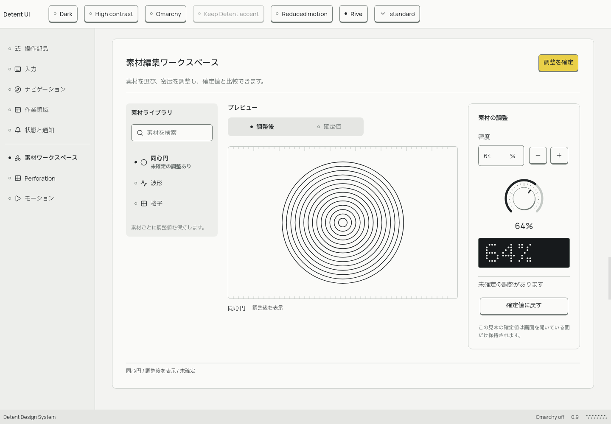
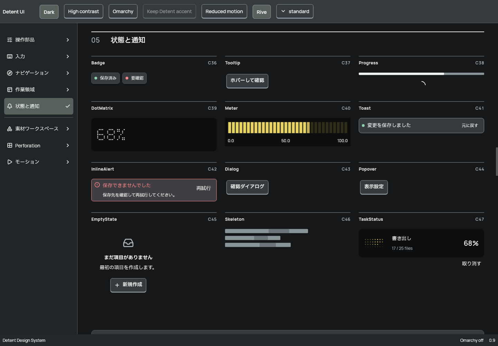
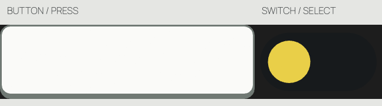
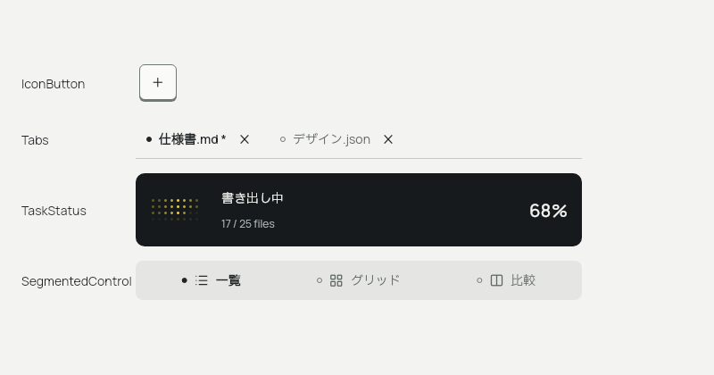
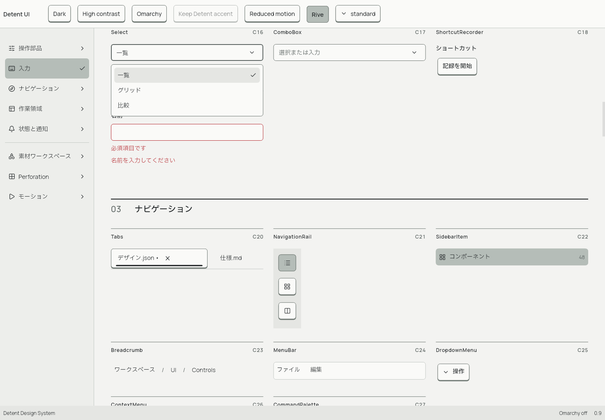

# Detent Design System

Flutter デスクトップ向けの UI パッケージ。50部品（C01–C50）を
`Detent` 接頭辞の Widget として実装しています。デザイン版は0.4、実装版は0.9.0です。操作アニメーションとPerforationはFlutter、既存の処理状態アニメーションはRiveで実装しています。

## ギャラリー

サイドバーから、用途別の部品カタログと操作できる画面作例に移動できます。
選択は項目の先頭の小さな表示灯（点いた墨色の丸）で示し、黄色は保存や確定などの主要操作に使います。
ギャラリーは仕様書のような体裁です。番号付きの節を太い罫線で区切り、各部品は細い罫線の下に部品名とC番号を刻印風に並べます。厚みを持つのは操作できる部品だけです。
以下はFlutterギャラリーのスクリーンショットです（1440×1000px）。

### ライト：基本の操作部品

ボタン、キーキャップ、排他的な選択、チェックボックス、スイッチ、スライダー、ノブ、数値入力。
ボタンとキー、切り替えと選択、値の調整の順に部品を確認できます。



### ダーク：同じ部品を暗い作業環境へ

背景・操作面・文字の色を役割ごとに切り替え、主要操作の黄色を維持します。
ギャラリー上部からテーマ、高コントラスト、動きの抑制、表示密度を切り替えられます。



### 作業領域：情報を整理する部品

アプリのシェル、ヘッダー付きパネル、ツールバー、リサイズできる分割領域、ステータスバー、ツリー、データ表。
これらを組み合わせて、一覧と詳細を並べるデスクトップ画面を構成します。



### 素材ワークスペース

左で素材を探し、中央でプレビューを比較し、右で密度を調整します。ノブと数値入力は同じ値に連動します。



### フィードバック：値と処理状態を伝える部品

ドット数字、メーター、進捗、通知、エラー、空状態、読み込み表示、タスク状態。
状態は色に加えて文字やアイコンでも伝えます。



ボタン・スイッチ・ノブ・選択面などの操作はFlutterで描画・アニメーションします。
ギャラリー上部の「Rive」は処理表示だけを切り替えます。操作部の動きは変わりません。

### Riveの動き

Progress・ライブMeter・処理中のTaskStatus・Skeletonを、実際の `.riv` から書き出したサンプルです。
メーターと進捗の値は固定し、処理中の光・ドット・掃引だけを動かしています。





## 基本的な使い方

```dart
import 'package:flutter/widgets.dart';
import 'package:detent_ui/detent_ui.dart';

DetentApp(
  home: DetentAppShell(
    body: DetentPanel(
      header: const Text('プロジェクト'),
      child: DetentButton(
        label: '保存',
        variant: DetentButtonVariant.primary,
        onPressed: save,
      ),
    ),
  ),
)
```

全コンポーネントは `package:flutter/widgets.dart` の基礎 Widget で構成しています。
`DetentApp` も `WidgetsApp` を使用します。入力・メニュー・通知・ダイアログを含め、
MaterialApp、Scaffold、Material、Theme の祖先は必要ありません。
既存の `WidgetsApp` では、対象領域を `DetentTheme(data: data, child: ...)` で包んでください。
ポップアップやダイアログを使う場合は Navigator / Overlay が必要です（WidgetsApp の home / routes で用意されます）。

```dart
WidgetsApp(
  color: const Color(0xFFE9CF48),
  pageRouteBuilder: <T>(settings, builder) => PageRouteBuilder<T>(
    settings: settings,
    pageBuilder: (context, animation, secondaryAnimation) => builder(context),
  ),
  home: DetentTheme(
    data: const DetentThemeData(),
    child: DetentBox(body: YourScreen()),
  ),
)
```

テーマ切替は `DetentThemeMode`、範囲値は `DetentRangeValues` を使います。
0.6 以前の `materialTheme` は削除しました。`DetentToast.show` の戻り値は `DetentToastHandle` で、
`close()` で通知を閉じられます。値とイベントはアプリ側で管理します。

### Keycap の幅

```dart
Row(children: const [
  DetentKeycap(label: 'K'),                 // 1u（既定）
  SizedBox(width: 8),
  DetentKeycap(label: 'Shift', units: 1.5),
  SizedBox(width: 8),
  DetentKeycap(label: 'Enter', units: 2),
])
```

`units` はキー間隔を含めたピッチの倍率です。標準密度では 1u = 40px、1.5u = 64px、
2u = 88px、6.25u = 292px。幅は `(controlHeight + 8) * units - 8`、高さは `controlHeight + 2` です。
0.5u 以上の有限値を指定でき、押下状態や Rive の読み込みで配置寸法は変わりません。

### Select / ComboBox

入力枠・候補パネル・行・チェック表示・スクロールを共通実装にしています。
Select はホストが値を管理する選択専用、ComboBox は文字入力で候補を絞り込めます。
上下キー、Home / End、Enter、Escape、無効候補のスキップに対応します。
候補面は角丸6px、行高36px（拡大文字では伸長）、入力枠との間隔8pxです。



[ComboBoxの候補面](example/screenshots/combobox.png)・[Rive無効時の同寸描画](example/screenshots/static.png)も確認できます。

## 0.9.0 の変更点

- 文字の役割を `DESIGN_SYSTEM.md` §5.2 に揃えました：`page`・`section`・`componentTitle`・`control`・`body`・`caption`・`label`・`readout`。旧名（`bodyMedium`・`bodySmall`・`labelLarge`・`sectionTitle`・`title`）は非推奨で、0.10 の後に削除します。
- 状態色に `warning`・`info`・`onDanger` を追加しました。警告に主要操作の黄色を使わなくなりました。`DetentPalette` では省略でき、省略時は既定値を使います。
- 角丸と余白の定数 `DetentRadius`（mark 2 / control 6 / menu 8 / panel 10 / chassis 14）と `DetentSpace` を追加しました。
- `DetentSwitch` は既定で縦のスライドスイッチになりました（上がON、横にON / OFFを刻印）。暗い溝に大きなつまみを置いたデフォルメした形で、つまみと目盛りはSliderと同じ描き方です。`axis: Axis.horizontal` で同じスライドスイッチを横に置けます（右がON、両端にOFF / ON）。矢印キーは向きに沿って値を直接設定します。
- `DetentSlider` と `DetentRangeSlider` に `axis: Axis.vertical` と `length` を追加しました。RangeSliderの縦型は上限を上、下限を下に表示します。オーディオミキサーのフェーダーのように下が最小、目盛りは右側です。見た目は横型と同じつまみです。
- `DetentRotaryKnob` の見た目を作り直しました。外周の弧がSliderと同じ太さで値まで濃く埋まり、目盛りと明るい円盤の指針で角度を示します。数値はつまみの下に表示します（つまみの真ん中ではなくなったため、高さが数値の行の分だけ増えます）。
- ボタンと入力欄の左右paddingは12pxです。一覧・表・ツリー・サイドバーの行は行ごとの枠をなくしました。
- 選択の表し方を表示灯（`DetentSelectionLamp`）に統一しました（`DESIGN_SYSTEM.md` §5.10）。選べる項目の先頭に直径6pxの灯を置き、選んだ項目だけ `text.primary` で点け、文字を semibold にします。選択に面（`selection.surface`）を塗らず、移動先に `›` や `✓` を付けません。
  - 対象: SidebarItem・ListRow・TreeView・NavigationRail・Tabs・SegmentedControl・ToggleButton・Select / ComboBox の候補。`DetentTile(lamp: true)` で独自の行にも付けられます。
  - `DetentButton.selected` / `DetentIconButton.selected` は `bool?` になりました。`null`（既定）は通常のボタン、`true` / `false` は灯付きの切り替えです。選択中に面が沈んだままになる表現はやめました。
  - SegmentedControl は溝とスライドキー（§5.9）をやめ、板の上に灯付きの選択肢を並べる形にしました。
  - NavigationRail はアイコンの下にラベルを表示します（幅76px）。
  - Tabs の未保存の印は ` •` から ` *` に変わりました（灯と見分けるため）。
  - TreeView の選択行の `✓`、DataTable の選択行の面をなくしました。DataTable はチェックボックスと文字の太さで選択を示します。
  - CommandPalette の強調中のコマンドは選択ではなく一時的な強調なので、面のままです。
  - Checkbox・RadioGroup・Switch とメニューのチェック項目は値そのものを示す部品なので、灯を付けません。

## 実装内容

- 全48 Widget: controls / inputs / navigation / layout / data / feedback。
- 正本JSONから生成した364トークン。4色テーマ、3密度、OSに追従するreduced motion。
- Manrope、IBM Plex Sans JP（400 / 500 / 600）をライセンスと共に同梱。
- Lucide 16px。`forui_lucide` はアイコン資産だけを供給し、ForuiのUI部品には依存しません。
- ボタンの配置領域は標準50px（操作面40＋底面2＋上下フォーカス余白8）。
- メニュー、検索、ショートカット記録、数値入力、ノブ、ツリー、リサイズ境界の操作。
- 表は固定ヘッダー＋遅延行構築。行の安定ID・選択・ソート通知をホストが管理。
- 通知のhover/focus中のタイマー停止、ダイアログの安全な初期フォーカスを指定するAPI。
- `example/lib/main.dart` に48部品、テーマ・密度・motion・Riveの切替、タスク状態の操作プレビュー。

## ギャラリーを実行

開発環境: Flutter 3.50.0-0.3.pre / Dart 3.14.0-294.0.dev。
この環境のSDKと既存のLucide資産に合わせ、Flutter >=3.47.0-0 / Dart >=3.13.0-0です。

```sh
cd example
flutter pub get
flutter run -d linux
```

Linux / macOS / Windows と Android / iOS の生成済みランナーを同梱しています。
対応方針はデスクトップ向けです。各OSでのビルド・実機動作とモバイル向けレイアウトは未検証です。
ATELIER-STUDIO側の既存UIの置き換えは行っていません。

## Rive

`assets/rive/detent.riv` はRive CLI 1.8.0で生成した、スクリプトなしのランタイムファイルです。
編集可能な制作ソースは `rive/detent/scene.rml`、プロパティとアニメーションの一覧は `assets/rive/manifest.json` にあります。
処理表示専用の7アートボード（Progress / CircularProgress / Spinner / Meter / TaskStatus / TaskGlyph / Skeleton）を収録しています。
操作部向けのアートボードは同梱せず、ファイルは25,491 bytesです（旧95,786 bytesから約73%削減）。

| 部品 | アニメーションの実装 |
|---|---|
| Button / IconButton / ToggleButton / Keycap | Flutter。押下60ms・復帰120ms、hover色の遷移 |
| Checkbox / RadioGroup / Switch | Flutter。選択120–160ms、スイッチのつまみ移動と途中反転 |
| SegmentedControl / Tabs / 選択できる行 | Flutter。表示灯の点灯・消灯120ms |
| Slider / RangeSlider / RotaryKnob | Flutter。実値へ即時追従、操作中のつまみの反応 |
| TreeView / DotMatrix / InlineAlert / EmptyState | Flutter。展開矢印の回転、数字・状態の切り替え |
| Progress / Button loading | Rive。実進捗の光、不明時の流れる帯・回転弧。ボタンの操作面はFlutter |
| Meter | Rive。実値に同期する32本のバーに光の脈動。`active: false` で静止 |
| TaskStatus | Rive。処理中／キャンセル中のドット波、完了アイコン。完了後のループなし |
| Skeleton | Rive。読み込み中の掃引 |

`DetentApp` / `DetentThemeData` は `riveEnabled: true` が既定です。
`DetentApp(riveEnabled: false, home: ...)` で処理表示もFlutterの代替描画に切り替えます。
通常の操作部はこの設定によらずRiveの読み込み・コントローラー生成を行いません。

Flutterは値・イベント・編集・Focus・Semanticsを管理します。操作の結果はアニメーションの終了を待たず通知されます。
通常ボタンはSpace / Enterを離した時点で確定し、Escapeで中止できます。

高コントラスト、reduced motion、Rive無効化、読み込み失敗では処理表示をFlutter描画へ切り替えます。
Riveファイルは使用中共有し、controller / view model / bindingは各表示で分離・破棄します。
画面外・TickerMode無効・バックグラウンドでは停止し、復帰時に現在の値を反映します。
進捗率とメーターは実データを保ち、演出で架空の値を生成しません。
進捗未取得のTaskStatusは率を表示せずドットの波で活動を伝え、待機・完了後は静止します。

独自の処理表示にも `DetentRiveArtwork` を利用できます。描画はIgnorePointer / ExcludeSemantics付きで、
ラベルはホスト側に用意してください。

```dart
SizedBox(
  width: 32, height: 32,
  child: DetentRiveArtwork(
    artboard: 'Spinner',
    state: DetentSkinState(progress: .25, indeterminate: true),
    fallback: SizedBox.shrink(),
  ),
)
```

`progress` は0…1、`indeterminate` は処理中のループ、Progressの `taskState: 1` は実進捗の光です。
`TaskGlyph` の `taskState` はidle=0 / running=1 / success=2 / error=3 / canceled=4 / canceling=5。
メーターのバー本数を標準32以外に指定した場合は、指定本数のFlutter描画を保持します。
0.7からの移行では、独自の `DetentRiveArtwork` に操作部のアートボード名を指定していた箇所を通常のWidgetへ変更してください。

`rive` runtimeは0.14.11に固定。Linuxの初回テスト前は `dart run rive_native:setup --platform linux` を実行します。

```sh
python3 tool/generate_tokens.py
python3 tool/generate_rive.py
rive rive/detent --verify
rive inspect rive/detent --json
rive rive/detent --once
python3 tool/render_motion_preview.py  # Rive CLI + ffmpegでGIF再生成
```

Riveアカウントへのpush・publishは行いません。ローカルの未署名・スクリプトなしファイルです。

## 検証

パッケージルートから実行します（RiveのLinuxテストライブラリ探索の基準位置です）。

```sh
flutter analyze
flutter test
flutter test example/test/gallery_test.dart
```

テスト範囲: 押下cancel・二重発火抑制・外部値更新・キーボード・数値制約・通知タイマー・
表の遅延構築・メニュー終了・Rive障害時代替・7アートボードの実runtime読込とdata binding、Flutter操作部の移動・途中反転・画面外／背景停止・フォーカス維持。
ギャラリーは4テーマと文字200%、幅1024 / 1440 / 1920を確認します。
OS実機のIME・スクリーンリーダー・DPI・性能測定は別途必要で、Verified認定ではありません。

設計の根拠: `DESIGN_SYSTEM.md`、`SPECIFICATION.md`、`design_tokens.json`、`component_registry.json`。

### 動きの負荷を確認する

ギャラリーのデバッグ実行には開発用の負荷が含まれます。性能の確認は profile ビルドで行います。

```sh
cd example
flutter run --profile -d web-server --web-port 48732 --dart-define=DETENT_PERF=true
```

`DETENT_FRAME` に5秒区間のフレーム数、Flutter build / raster の中央値と95パーセンタイルを出力します。
同じ表示位置で Rive を切り替えて比較してください。通常の起動では計測しません。
Rive の描画を再描画境界で分離し、画面外の代替進捗アニメーションも TickerMode で停止します。


## Perforation（穴）

穴は「物理的な開口」だけを表し、次の二つにしか使いません（判断の理由は `DESIGN_SYSTEM.md` §5.8）。

| 役割 | 部品 | 置く所 |
|---|---|---|
| P1 Grip（掴む所） | `DetentGrip` (C49) | `DetentSplitView` の境界、並べ替えできる `DetentListRow` の行頭 |
| P3 Mark（筐体の刻印） | `DetentChassisMark` (C50) | `DetentStatusBar` の右端。1ウィンドウに1つ |

```dart
// P1: 並べ替えできる行。onMoveUp / onMoveDown を渡すと行頭に Grip が出る。
// Grip を縦にドラッグするか、行にフォーカスして Alt+↑ / Alt+↓ で1行ずつ動く。
DetentListRow(
  label: track.name,
  onMoveUp: i == 0 ? null : () => moveTrack(i, i - 1),
  onMoveDown: i == last ? null : () => moveTrack(i, i + 1),
);

// P1: SplitView の境界は Grip。ホバー・ドラッグ・フォーカス中に穴が文字色で埋まる。
DetentSplitView(leading: browser, trailing: arrange);

// P3: StatusBar は右端に Mark を出す。同じウィンドウの二つ目のバーだけ外す。
const DetentStatusBar(children: [Text('すべて保存済み')]);
const DetentStatusBar(showMark: false, children: [Text('検索結果 12件')]);
```

- Grip は穴 2px・間隔 4px の2列（太さ8px）。普段は地の穴の色、操作中だけ `text.primary` で埋まる。黄色は使わない。`DetentGrip` は描画だけで、入力と Semantics は持ち主の部品が持つ。
- 並べ替えは Grip のドラッグ（1行の高さごとに1つ動く）、Alt+↑↓、支援技術のカスタム操作（「上へ移動」「下へ移動」）の三通りで同じ操作になる。順序はホストが持つ。
- Mark は 52×14px、穴 3px の六角配置。色・動き・Semantics を持たない。幅が足りないとき（狭いバー・大きな文字）は内容を優先して表示しない。
- 進捗・レベル・接続状態・額縁・ポインタの飾りには穴を使わない。値は `DetentProgress` / `DetentMeter` / `DetentTaskStatus` で示す。
- `DetentHoleGrid` / `DetentPerforationPattern` は Grip と Mark の描画用 Primitive。描画は CustomPainter 一枚にまとめ、穴ごとの Widget・Semantics は作らない。

0.9.0 で `DetentPerforationSurface`・`DetentResonanceGrid`・`DetentSpeakerMatrix`・`DetentHole` と `DetentPerforationCoverage`・`DetentPerforationSpeed` を削除した。移行先は次のとおり。

| 削除したもの | 移行先 |
|---|---|
| `DetentPerforationSurface` | `DetentPanel` か、罫線と余白（§5.7） |
| `DetentSpeakerMatrix.progress` / `.loading` | `DetentProgress` / `DetentTaskStatus` |
| `DetentSpeakerMatrix.level` / `.signal` | `DetentMeter` |
| `DetentSpeakerMatrix.status` | `DetentBadge` か `DetentInlineAlert` |
| `DetentResonanceGrid` | なし（値と関係のない反応は使わない） |

ギャラリーの Perforation 節では、Grip の状態、SplitView・ListRow・StatusBar・AppShell への組み込み、使わない場面を確認できます。
Token正本は`design_tokens.json`。`python3 tool/generate_tokens.py`でDartと確認用スナップショットを再生成します。見た目の確認は `tool/update_screenshots.sh` でギャラリーのスクリーンショットを撮り直して行います（変更前の画像は `build/screenshots/before/` に退避されます）。
